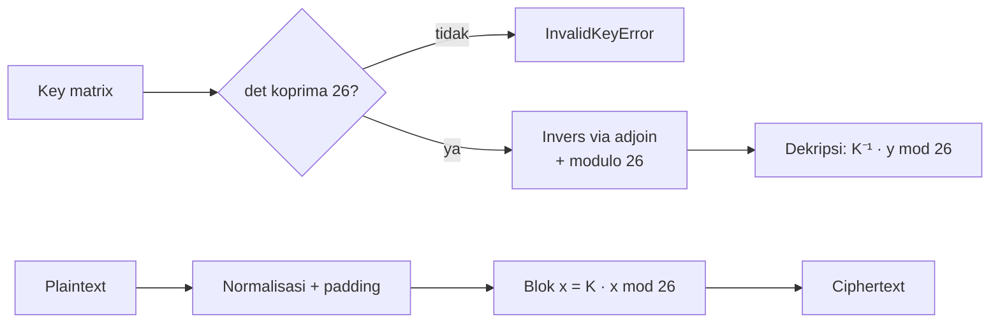

<div align="center"><h3><a href="#english-version">🇬🇧 English</a> | <a href="#versi-bahasa-indonesia">🇮🇩 Bahasa Indonesia</a></h3></div>

<a id="english-version"></a>

<div align="center">

# Applied Cryptography in Python

**The Hill cipher as a tested library — exact integer arithmetic, validated keys, known-answer tests.**


</div>

---

## Overview

The **Hill cipher** (Lester Hill, 1929) is a polygraphic substitution cipher.
Plaintext is cut into blocks of `n` letters, each block is read as a column
vector `x`, and the ciphertext block is

```
y = K · x   (mod 26)
```

Decryption multiplies by the modular inverse of `K`, which exists only when
`det(K)` is coprime with 26 — never divisible by 2 or 13. Roughly a third of all
key matrices fail that test, so this implementation validates the key at
construction time and raises a clear `InvalidKeyError` instead of failing
later inside the inverse.

This repository turns a single coursework cell into a small library with type
hints, docstrings and 25 tests, because the interesting part of the exercise is
the modular linear algebra, not the print statement.

## Key Features

- **Exact integer arithmetic.** The determinant comes from Bareiss
  fraction-free elimination and the inverse from the adjugate matrix, so there
  is no floating-point rounding. `numpy.linalg.det` silently drifts on larger
  keys; this does not.
- **Explicit key validation.** Square, integer, at least 2x2, and invertible
  modulo 26 — each failure produces its own message.
- **Any block size.** 2x2, 3x3 or larger through the same API.
- **Deterministic normalisation.** Input is lower-cased and stripped to `a-z`;
  the final block is padded so every ciphertext length is a multiple of the
  block size.
- **Known-answer tests.** The textbook key `[[3, 3], [2, 5]]` maps `help` to
  `hiat`, and that is asserted.

## Quick Start

```bash
git clone https://github.com/glen1599/applied-cryptography-python.git
cd applied-cryptography-python

python -m venv .venv && source .venv/bin/activate
pip install -r requirements.txt
```

```python
import sys; sys.path.insert(0, "src")
from applied_crypto import HillCipher, InvalidKeyError

cipher = HillCipher([[3, 3], [2, 5]])

print(cipher.block_size)     # 2
print(cipher.determinant)    # 9
print(cipher.is_invertible)  # True

secret = cipher.encrypt("help")
print(secret)                # hiat
print(cipher.decrypt(secret))  # help
```

A key that cannot be inverted is rejected up front:

```python
HillCipher([[1, 2], [3, 4]])
# InvalidKeyError: determinant -2 is not coprime with 26: the key is not invertible
```

## API

| Member | Description |
| --- | --- |
| `HillCipher(key, padding="x")` | Validates the key and precomputes its inverse |
| `.encrypt(plaintext)` | `K · x (mod 26)`, after normalising and padding |
| `.decrypt(ciphertext)` | `K⁻¹ · x (mod 26)` |
| `.block_size` | Key order `n` |
| `.determinant` | Exact integer determinant of the reduced key |
| `.is_invertible` | Whether the key can decrypt as well as encrypt |
| `inverse_modulo_matrix(matrix, modulus=26)` | Modular matrix inverse via the adjugate |
| `InvalidKeyError` | Raised for every unusable key |

## Project Structure

```
applied-cryptography-python/
├── src/applied_crypto/
│   ├── __init__.py
│   └── hill_cipher.py          # cipher + exact modular linear algebra
├── notebooks/
│   └── 01_hill_cipher.ipynb    # worked examples, key rejection, a corpus run
├── tests/
│   └── test_hill_cipher.py     # 25 tests
├── data/
│   └── sample_messages.txt
├── requirements.txt
└── pyproject.toml
```

> The package is named `applied_crypto` rather than `cryptography` on purpose:
> a local `cryptography` package would shadow the widely used PyPI library of
> that name.

## How the inverse is computed

Given a key `K`:

1. `det(K)` via Bareiss elimination — integer-preserving, so no rounding.
2. `det⁻¹ mod 26` via the extended Euclidean algorithm (`pow(det, -1, 26)`),
   raising `InvalidKeyError` when it does not exist.
3. `K⁻¹ = det⁻¹ · adj(K) mod 26`, where `adj(K)` is the transposed cofactor
   matrix built from integer minors.

`K · K⁻¹ ≡ I (mod 26)` is asserted in the test suite.

## Testing

```bash
pytest -q
```

Covers the known-answer vector, round trips at several message lengths,
block-size and padding behaviour, exact determinants (including a 4x4 case
where floating point would drift), singular-matrix detection, every key
validation path, and the modular inverse identity.

## Security note

The Hill cipher is **not** secure and is not intended to be used to protect
anything. It is linear, so a known-plaintext attack recovers the key from `n`
plaintext/ciphertext block pairs by solving a linear system mod 26, and it leaks
the plaintext's letter frequencies modulo the block size. The test suite covers
correctness, not security.

## License

MIT — see [LICENSE](LICENSE).

## Author

**Glen Devit Renaldi** — [@glen1599](https://github.com/glen1599)

---

<a id="versi-bahasa-indonesia"></a>

## Versi Bahasa Indonesia

**Hill cipher sebagai library Python yang teruji — aritmetika bilangan bulat eksak, key tervalidasi, known-answer test.**

### Kenapa proyek ini ada

Hill cipher adalah tugas kuliah kriptografi yang biasanya berhenti di satu cell notebook: enkripsi satu kalimat, lalu selesai. Masalahnya, implementasi seperti itu hampir selalu salah di satu titik yang sama — invers matriks modulo 26. Kalau determinannya genap atau habis dibagi 13, key tidak punya invers; banyak versi "lulus" karena mengabaikan kasus itu, bukan karena menanganinya.

Versi ini sengaja dibuat sebagai library sungguhan: key divalidasi saat dibuat, determinan dihitung eksak dengan eliminasi Bareiss (bukan `round(det)` dari float), invers modular dihitung lewat adjoin, dan setiap key yang tidak bisa dipakai melempar `InvalidKeyError` dengan alasan yang jelas. Ukuran blok bebas, bukan hanya 2×2 atau 3×3.

### Fitur utama

- 🔐 **Enkripsi/dekripsi Hill cipher** untuk blok ukuran berapa pun (`n × n`).
- 🧮 **Aritmetika eksak** — determinan integer via Bareiss, tanpa galat pembulatan float.
- ✅ **Validasi key** — menolak matriks yang determinannya tidak koprima dengan 26.
- 🧩 **Padding otomatis** — huruf `x` (bisa diganti) untuk blok yang tidak penuh.
- 🧪 **25 test** — termasuk known-answer vector dan kasus key yang tidak invertibel.
- 📦 **API kecil dan jelas** — `encrypt`, `decrypt`, `inverse_modulo_matrix`.

### Arsitektur



| Lapisan | Teknologi | Fungsi |
| --- | --- | --- |
| Bahasa | Python 3.10+ | Type hints, `dataclass`, `functools` |
| Matematika | NumPy | Operasi matriks, perkalian modulo |
| Aritmetika | `fractions` / int murni | Determinan Bareiss tanpa float |
| Test | pytest | 25 kasus, termasuk known-answer |
| Notebook | Jupyter + Matplotlib | Eksplorasi visual cipher |

### Instalasi

```bash
git clone https://github.com/glen1599/applied-cryptography-python.git
cd applied-cryptography-python
python -m venv .venv && source .venv/bin/activate
pip install -r requirements.txt
```

### Cara pakai

```python
from applied_crypto import HillCipher

cipher = HillCipher([[6, 24, 1], [13, 16, 10], [20, 17, 15]])
ciphertext = cipher.encrypt("ACT")
print(ciphertext)          # "POH"
print(cipher.decrypt(ciphertext))  # "ACT"
```

> [!TIP]
> Cek `cipher.is_invertible` sebelum menyimpan key. Key yang hanya bisa enkripsi
> (determinan genap atau kelipatan 13) tetap valid secara matematis, tapi tidak
> bisa dipakai untuk dekripsi.

### Testing

```bash
pytest -q      # 25 passed
```

### Struktur proyek

```text
applied-cryptography-python/
├── src/applied_crypto/     # HillCipher, modular inverse, util
├── tests/                  # 25 known-answer dan edge-case test
├── notebooks/              # eksplorasi cipher
├── data/                   # contoh plaintext
├── pyproject.toml
└── requirements.txt
```

### Catatan keamanan

Hill cipher **bukan** kriptografi modern. Ini alat belajar: ia rentan terhadap
known-plaintext attack dan tidak punya diffusion seperti AES. Jangan dipakai untuk
data nyata.

### Rencana ke depan

- [ ] Varian Hill cipher dengan alfabet campuran (huruf, angka, spasi)
- [ ] CLI `hill encrypt/decrypt` dengan key dari file
- [ ] Property-based test dengan Hypothesis
